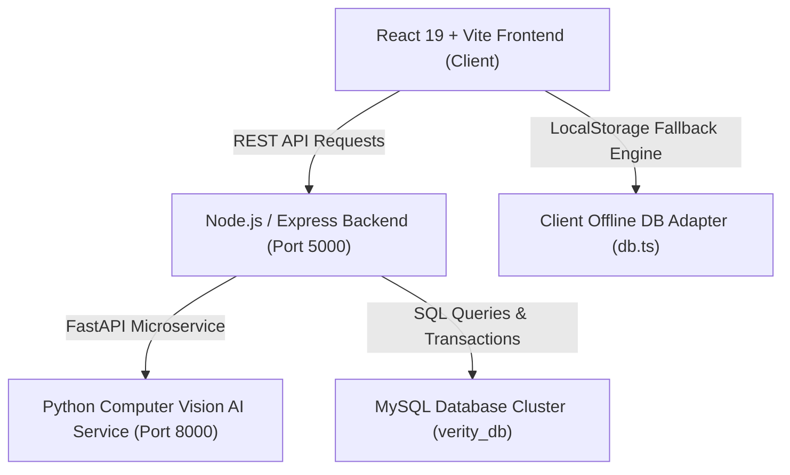

# VERITY Architecture & System Specifications

## 1. High-Level System Architecture

VERITY is architected as a modular, 3-tier microservice ecosystem designed for low latency (< 200ms) and multi-layered zero-trust security.

---

## 2. 6-Layer Zero-Trust Verification Model

During an active attendance check-in, VERITY executes 6 mandatory security layers before granting a `VERIFIED` status:

| Layer | Stage Name | Verification Engine | Security Target |
| :--- | :--- | :--- | :--- |
| **Layer 1** | Account & Enrolment | Express Auth Middleware | Verifies user enrollment status & face template registration |
| **Layer 2** | Dynamic Session QR Token | HMAC-SHA256 Token Validator | Validates 15-second rotating QR challenge token |
| **Layer 3** | Face Identity Match | OpenCV + Facial Vector Model | Compares live camera image against enrolled 128-D embedding (Threshold: 85%) |
| **Layer 4** | Passive 3D Liveness Test | Micro-Gesture & Depth Analyser | Detects 2D screen playback & photo spoofing attempts |
| **Layer 5** | Classroom Geofence | Haversine Distance Engine | Ensures student GPS coordinates are within classroom radius (e.g. 25m) |
| **Layer 6** | Temporal & Anti-Replay | MySQL Unique Constraints | Prevents duplicate check-ins and enforces late arrival thresholds |

---

## 3. Data Flow & Transaction Security

1. **Session Creation**: Faculty launches a session. The server generates dynamic QR tokens (`VERITY-SESS-9938-X7K`) that rotate every 15 seconds.
2. **Student Check-In**: Student scans QR code, captures camera frame, and sends check-in payload.
3. **Face Identity Check**: AI microservice compares facial features. If match < 85%, check-in **FAILS IMMEDIATELY**.
4. **Attendance Recording**: Upon passing all checks, an atomic MySQL transaction inserts into `attendance` with `UNIQUE(session_id, student_id)` constraint preventing duplicate attempts.
